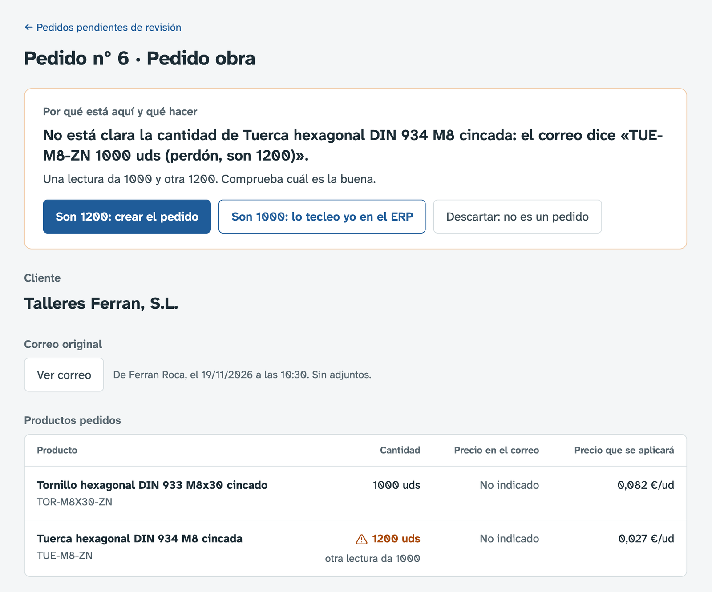
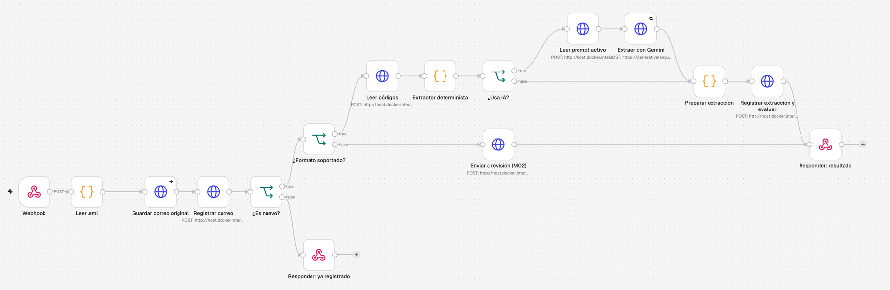
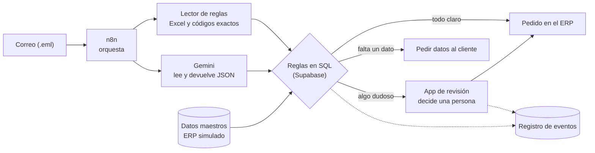

# Entrada automatizada de pedidos B2B

### [Ver la página del caso](https://davidlarre.github.io/b2b-order-intake-automation-case-study/) · [Ver la demo (3 min)](https://davidlarre.github.io/b2b-order-intake-automation-case-study/video/demo-v1.mp4)

> **In English.** A portfolio case study that turns B2B customer emails (free text, Excel) into validated ERP orders.<br>
> It shows how AI extraction, SQL business rules and human review work together, with a small evaluation and its limits stated openly.<br>
> The company and all data are fictional, and the project was built with AI assistance ([details, in Spanish](AI_USAGE.md)).

https://github.com/user-attachments/assets/822c34dc-cfea-4710-ab3f-1b31e22ba877

**Caso de estudio de portfolio: del correo del cliente al pedido en el ERP, con reglas, IA y revisión humana.**

Un distribuidor recibe unos 1.800 pedidos al mes por correo, en texto libre, Excel o PDF, y alguien los teclea uno a uno en el ERP. El sistema lee cada correo y lo valida con reglas contra los datos maestros. Crea solo los pedidos claros y deja el resto en una cola en la que una persona decide, con el motivo explicado.

> **Caso ficticio y datos sintéticos.** Orvalle Suministros Industriales, sus clientes y sus cifras son inventados. No es un proyecto en producción ni un cliente real. Está **hecho con asistencia de IA, y se dice**: [AI_USAGE.md](AI_USAGE.md).

¿Solo tienes cinco minutos? Lee [el caso en una página](docs/caso.md), sin tecnicismos.

## Cómo se ve

**La cola de revisión.** Cada pedido que el sistema no da por bueno llega con su porqué.


**Un pedido dudoso.** El cliente se corrige a sí mismo en la misma línea. Las dos lecturas no coinciden, y decide una persona.



**El flujo en n8n.**



## Resultados (v1.1)

20 correos de desarrollo, en las tres configuraciones del sistema:

| Configuración | OK | ACEPTABLE | FALLO | Pedidos automáticos erróneos o indebidos |
|---|---|---|---|---|
| Solo reglas | 7 | 5 | 8 | 8 de 11 |
| Solo IA | 15 | 1 | 4 | 0 de 9 |
| Híbrido | 15 | 4 | 1 | 0 de 8 |

**Qué cambió en la v1.1:** una regla del prompt para las correcciones del cliente, y un fallo de la IA manda el caso a la cola (M03); el vídeo no se ha tocado y muestra la [v1](eval/resultados-v1.md).

ACEPTABLE es una salida segura que no era la esperada: el caso llega a una persona.

- **Sin IA no basta:** un lector de reglas deja líneas fuera y crea el pedido igualmente.
- **Los 5 FALLO con IA son M03:** Gemini estaba saturado (503) y los cinco correos quedaron en la cola. En la pasada anterior fueron 10; ambas están publicadas. El caso 16, que en la v1 fallaba, ya no falla.
- **Cuando Gemini contesta, "solo IA" sale algo mejor que el híbrido.** El híbrido paga tres revisiones innecesarias por tener una segunda lectura. Esa red existe para cuando la IA lea mal, y en 20 casos no llegó a hacer falta.
- **Son pocos casos, y de desarrollo.** Sin prueba congelada ni revisión humana de las etiquetas. Con 0 errores en 8 pedidos automáticos, el error real puede llegar a 3/8, un 38 %.

Los fallos, uno a uno, y las limitaciones: **[eval/resultados-v1-1.md](eval/resultados-v1-1.md)**, con la comparación caso a caso con los [resultados v1](eval/resultados-v1.md).

## Arquitectura



- **La IA lee; las reglas deciden.** No se usa la confianza que declara el modelo. La IA no identifica al cliente ni acepta precios.
- **Las reglas viven en la base de datos,** con sus permisos. La app no puede saltárselas.
- **Se evalúa lo que funciona:** la evaluación entra por el mismo flujo de n8n que la demo.

El diseño completo está en [04](docs/04-solution-design.md), y las decisiones, en los [ADR](docs/decisions/).

## Ejecutarlo en local

Todo es gratuito. Hace falta Docker, la CLI de Supabase, [uv](https://docs.astral.sh/uv/), Node y una clave gratuita de Google AI Studio.

1. **Configuración.** `cp .env.example .env` y rellena los valores; el fichero explica cada uno.
2. **Base de datos y n8n.**
   ```
   supabase start
   scripts/n8n.sh up
   ```
3. **Flujo de n8n** (http://localhost:5678). Importa [el flujo](n8n/flujos/corte-vertical-pedido-desde-eml.json), crea tres credenciales *Header Auth*, asígnalas a sus nodos y publica el flujo:

   | Credencial | Cabecera | Valor |
   |---|---|---|
   | Entrada de pruebas · token | `X-Pruebas-Token` | `PRUEBAS_WEBHOOK_TOKEN` de `.env` |
   | Supabase local · automatización | `apikey` | `SECRET_KEY` de `supabase status -o env` |
   | Gemini · AI Studio (nivel gratuito) | `x-goog-api-key` | tu clave de Gemini |

4. **Demo.** Reinicia la base local (**borra sus datos**; pide confirmación) y procesa los 7 correos de la demo:
   ```
   scripts/preparar_demo.sh
   ```
5. **App de revisión.**
   ```
   supabase status -o env | sed -n 's/^API_URL=/VITE_SUPABASE_URL=/p; s/^PUBLISHABLE_KEY=/VITE_SUPABASE_PUBLISHABLE_KEY=/p' | tr -d '"' > app/.env.local
   cd app && npx pnpm@12.4.2 install --frozen-lockfile && npx pnpm@12.4.2 dev
   ```
   Abre http://127.0.0.1:5173 y entra con `gestora@orvalle.example`. La contraseña la genera la demo en `.env` (`ADV_GESTORA_PASSWORD`).

Tests: `uv run pytest`, y `node --test` en `n8n/modulos/extractor` (tras `npx pnpm@12.4.2 install --frozen-lockfile` en esa carpeta).

## Qué no hace todavía

- **No clasifica el correo.** Una consulta que mencione un código y una cantidad podría acabar en pedido.
- **Faltan reglas:** R02, R08, R11 y parte de R12 están hechas. Faltan, entre otras, duplicados (R07), unidades y embalajes (R10) e importe máximo (R13).
- **No lee Gmail ni envía correos.** Entra por un webhook de pruebas, y "pedir datos" queda registrado, pero no sale ningún correo.
- **No aprueba precios por correo** y **no lee PDF** (van a revisión).
- **No hay migración de datos maestros** (la Parte A): se arranca con 3 clientes y 10 productos limpios.

## Qué viene después

Un conjunto de 80 correos con generador, etiquetado a mano y prueba congelada, las reglas que faltan y la migración de datos maestros. El trabajo empezado está en la rama `datos-evaluacion`. Detalle en el [plan](docs/00-project-plan.md#siguiente-fase).

## Uso de IA

El proyecto se ha desarrollado con Claude, y la solución usa Gemini para leer los correos. Qué ha hecho la IA, qué es mío y qué no se debe interpretar del resultado: **[AI_USAGE.md](AI_USAGE.md)**.

## Documentación

| Documento | Qué es |
|---|---|
| [Página del caso](https://davidlarre.github.io/b2b-order-intake-automation-case-study/) | La versión para ver en el navegador ([fuente](site/index.html)) |
| [El caso en una página](docs/caso.md) | Sin conocimientos técnicos |
| [Guion del vídeo](docs/guion-video.md) | La demo en 3 minutos |
| [00 Plan](docs/00-project-plan.md) · [01 Decisiones](docs/01-reframe-decisions.md) | Cómo se ha trabajado |
| [02 Caso de negocio](docs/02-business-case.md) · [03 Discovery](docs/03-discovery-workshop.md) | El problema y su valor (supuestos declarados) |
| [04 Diseño](docs/04-solution-design.md) · [ADR](docs/decisions/) | La solución |
| [05 Datos y evaluación](docs/05-synthetic-data-and-evaluation-set.md) | La evaluación completa, diseñada y aplazada |
| [Resultados v1.1](eval/resultados-v1-1.md) · [Resultados v1](eval/resultados-v1.md) · [Registro de cambios](eval/registro-de-cambios.md) | Lo que se ha medido |
