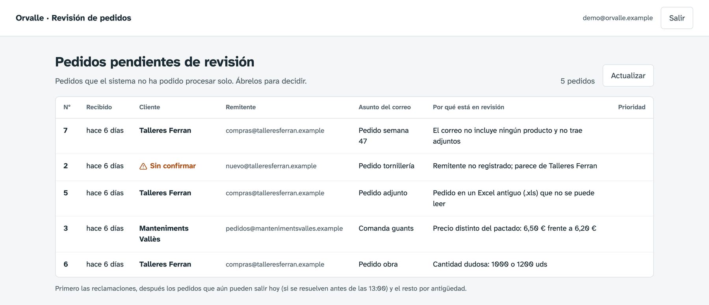
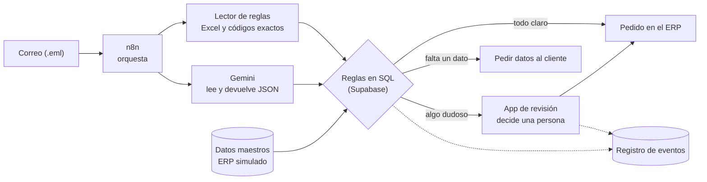

# Entrada automatizada de pedidos B2B

### [Ver la página del caso](https://davidlarre.github.io/b2b-order-intake-automation-case-study/) · [Ver la demo de la v1 (3 min)](https://davidlarre.github.io/b2b-order-intake-automation-case-study/video/demo-v1.mp4)

> **In English.** A portfolio case study that turns B2B customer emails (free text, Excel) into validated ERP orders.<br>
> It shows how AI extraction, SQL business rules and human review work together, with a small evaluation and its limits stated openly.<br>
> The company and all data are fictional, and the project was built with AI assistance ([details, in Spanish](AI_USAGE.md)).

https://github.com/user-attachments/assets/822c34dc-cfea-4710-ab3f-1b31e22ba877

**Caso de estudio de portfolio: del correo del cliente al pedido en el ERP, con reglas, IA y revisión humana.**

Un distribuidor recibe unos 1.800 pedidos al mes por correo, en texto libre, Excel o PDF, y alguien los teclea uno a uno en el ERP. El sistema lee cada correo y lo valida con reglas contra los datos maestros. Crea solo los pedidos claros y deja el resto en una cola en la que una persona decide, con el motivo explicado.

> **Caso ficticio y datos sintéticos.** Orvalle Suministros Industriales, sus clientes y sus cifras son inventados. No es un proyecto en producción ni un cliente real. Está **hecho con asistencia de IA, y se dice**: [AI_USAGE.md](AI_USAGE.md).

¿Solo tienes cinco minutos? Lee [el caso en una página](docs/caso.md), sin tecnicismos.

## Cómo se ve

**La cola de revisión.** Cada pedido que el sistema no da por bueno llega con su porqué.



**Un pedido dudoso.** El cliente se corrige a sí mismo en la misma línea. Las dos lecturas no coinciden, y decide una persona.


**El flujo en n8n.**


## Resultados (v2: prueba congelada)

60 correos guardados aparte (tag `prueba-v2.1`) y ejecutados una sola vez por configuración. La métrica principal se mide en los 38 casos que el sistema construido puede resolver; los otros 22 necesitan reglas que aún no existen y se cuentan aparte ([alcance](eval/alcance-prueba-v2.md), fijado antes de congelar).

| Configuración | Automáticos erróneos o indebidos, 38 en alcance | OK | ACEPTABLE | FALLO |
|---|---|---|---|---|
| **Híbrido** | **1 de 10** | 36 | 0 | 2 |
| Solo IA | 1 de 10 | 36 | 0 | 2 |
| Solo reglas | 1 de 6 | 13 | 14 | 11 |

- **El error del híbrido es una consulta convertida en pedido** (P52: "¿tenéis…? Si es que sí, mandadlos"). En la pasada de solo IA, el mismo prompt la clasificó bien: es variación del modelo entre ejecuciones, no efecto de la configuración.
- **El error de solo IA lo evitó el híbrido** (P38): la IA leyó 400 donde el Excel decía 200 y el cliente dudaba. En el híbrido, el lector de reglas leyó 200, las lecturas no coincidieron y decidió una persona. Es la primera vez que la segunda lectura evita un pedido equivocado.
- **Con 1 error en 10 automáticos,** el error real podría llegar al 39 % (límite superior al 95 %). Son pocos casos, y una pasada por configuración.
- **Las reglas que faltan se notan:** en los 22 casos fuera de alcance, el híbrido y solo IA crean 12 pedidos automáticos, y los 12 son erróneos o indebidos (un cliente bloqueado, cajas tomadas como unidades, una cantidad anómala…).
- **Sin revisión humana:** los correos y las etiquetas los hizo una IA, con segunda lectura de otra IA; el catálogo es generado.

Informe completo, con los fallos uno a uno y los límites: **[06 · Informe de evaluación](docs/06-evaluation-report.md)**.

**Versiones anteriores, de desarrollo:** [resultados v1.1](eval/resultados-v1-1.md) y [v1](eval/resultados-v1.md), con 20 correos que se conocían al construir. **El vídeo muestra la v1:** no se ha regrabado, y no enseña la clasificación ni la lista "No son pedidos".

## Arquitectura



- **La IA lee; las reglas deciden.** No se usa la confianza que declara el modelo. La IA no identifica al cliente ni acepta precios.
- **Las reglas viven en la base de datos,** con sus permisos. La app no puede saltárselas.
- **Se evalúa lo que funciona:** la evaluación entra por el mismo flujo de n8n que la demo.

El diseño completo está en [04](docs/04-solution-design.md), y las decisiones, en los [ADR](docs/decisions/).

## Ejecutarlo en local

Todo es gratuito. Hace falta Docker, la CLI de Supabase, [uv](https://docs.astral.sh/uv/), Node y una clave gratuita de Google AI Studio.

1. **Configuración.** `cp .env.example .env` y rellena los valores; el fichero explica cada uno.
2. **Base de datos y n8n.**
   ```
   supabase start
   scripts/n8n.sh up
   ```
3. **Flujo de n8n** (http://localhost:5678). Importa [el flujo](n8n/flujos/corte-vertical-pedido-desde-eml.json), crea tres credenciales *Header Auth*, asígnalas a sus nodos y publica el flujo:

   | Credencial | Cabecera | Valor |
   |---|---|---|
   | Entrada de pruebas · token | `X-Pruebas-Token` | `PRUEBAS_WEBHOOK_TOKEN` de `.env` |
   | Supabase local · automatización | `apikey` | `SECRET_KEY` de `supabase status -o env` |
   | Gemini · AI Studio (nivel gratuito) | `x-goog-api-key` | tu clave de Gemini |

4. **Demo.** Reinicia la base local (**borra sus datos**; pide confirmación) y procesa los 7 correos de la demo:
   ```
   scripts/preparar_demo.sh
   ```
5. **App de revisión.**
   ```
   supabase status -o env | sed -n 's/^API_URL=/VITE_SUPABASE_URL=/p; s/^PUBLISHABLE_KEY=/VITE_SUPABASE_PUBLISHABLE_KEY=/p' | tr -d '"' > app/.env.local
   cd app && npx pnpm@12.4.2 install --frozen-lockfile && npx pnpm@12.4.2 dev
   ```
   Abre http://127.0.0.1:5173 y entra con `gestora@orvalle.example`. La contraseña la genera la demo en `.env` (`ADV_GESTORA_PASSWORD`).

Tests: `uv run pytest`, y `node --test` en `n8n/modulos/extractor` (tras `npx pnpm@12.4.2 install --frozen-lockfile` en esa carpeta).

## Qué no hace todavía

- **Clasifica el correo, pero no busca el pedido original** de una modificación ni reenvía las facturas. Un correo clasificado como "otros" sale de la cola y se ve en la lista "No son pedidos". En la prueba, una consulta condicional se tomó por pedido ([informe](docs/06-evaluation-report.md)).
- **Faltan reglas:** R01, R02, R08, R11 y parte de R12 están hechas. Faltan, entre otras, duplicados (R07), unidades y embalajes (R10) e importe máximo (R13).
- **No lee Gmail ni envía correos.** Entra por un webhook de pruebas, y "pedir datos" queda registrado, pero no sale ningún correo.
- **No aprueba precios por correo** y **no lee PDF** (van a revisión).
- **Si falla la IA, no reintenta más tarde:** tras tres intentos seguidos, el caso se queda en la cola (M03) para una persona, y una caída general de Gemini no se distingue de un caso raro.
- **No hay migración de datos maestros** (la Parte A): un generador carga directamente su estado correcto (120 clientes, 498 productos y el histórico).

## Qué viene después

La prueba de los [80 correos](data/synthetic/evaluacion-v2/README.md) está [ejecutada](docs/06-evaluation-report.md). Faltan la revisión humana de las etiquetas, las reglas pendientes (las que más cuestan hoy: R04, R05, R07, R10 y R14), enlazar las respuestas del cliente y la migración de datos maestros. Detalle en el [plan](docs/00-project-plan.md#siguiente-fase).

## Uso de IA

El proyecto se ha desarrollado con Claude, y la solución usa Gemini para leer los correos. Qué ha hecho la IA, qué es mío y qué no se debe interpretar del resultado: **[AI_USAGE.md](AI_USAGE.md)**.

## Documentación

| Documento | Qué es |
|---|---|
| [Página del caso](https://davidlarre.github.io/b2b-order-intake-automation-case-study/) | La versión para ver en el navegador ([fuente](site/index.html)) |
| [El caso en una página](docs/caso.md) | Sin conocimientos técnicos |
| [Guion del vídeo](docs/guion-video.md) | La demo en 3 minutos |
| [00 Plan](docs/00-project-plan.md) · [01 Decisiones](docs/01-reframe-decisions.md) | Cómo se ha trabajado |
| [02 Caso de negocio](docs/02-business-case.md) · [03 Discovery](docs/03-discovery-workshop.md) | El problema y su valor (supuestos declarados) |
| [04 Diseño](docs/04-solution-design.md) · [ADR](docs/decisions/) | La solución |
| [05 Datos y evaluación](docs/05-synthetic-data-and-evaluation-set.md) | La evaluación completa, diseñada y aplazada |
| [06 Informe de evaluación](docs/06-evaluation-report.md) | La prueba v2, ejecutada una vez |
| [Resultados v1.1](eval/resultados-v1-1.md) · [Resultados v1](eval/resultados-v1.md) · [Registro de cambios](eval/registro-de-cambios.md) | Versiones anteriores, de desarrollo, y cada cambio del sistema |
