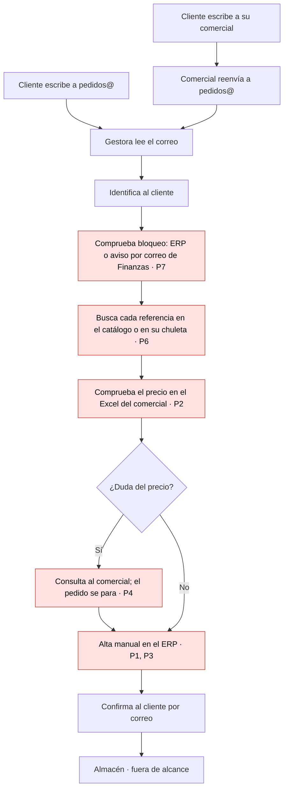

> **Taller simulado:** los roles, las respuestas y las cifras son ficticios. Sirve para mostrar el método de discovery, no como evidencia.

# 03 · Taller de discovery — Orvalle Suministros Industriales

Fase 1 del [plan](00-project-plan.md). Contrasta el [caso de negocio](02-business-case.md) y las [decisiones del reencuadre](01-reframe-decisions.md) con las personas que hacen y deciden el proceso. Las notas son un resumen por rol, no citas.

## Sesiones

Siete sesiones, en este orden:

| # | Con quién | Formato | Para qué |
|---|---|---|---|
| 1 | Dirección de operaciones (patrocinador) | Reunión de arranque, 45 min | Objetivos, criterio de éxito, presupuesto y horizonte |
| 2 | Responsable de administración de ventas (ADV) | Entrevista, 60 min | Volúmenes, picos, reglas actuales, miedos |
| 3 | Una gestora de ADV | Observación en su puesto, 2 h | Ver cómo se trabaja de verdad, no cómo se cuenta |
| 4 | Un comercial | Entrevista, 30 min | Tarifas, reenvíos, relación con el cliente |
| 5 | Finanzas | Entrevista, 20 min | Bloqueos de clientes |
| 6 | IT | Entrevista, 45 min | ERP, accesos, seguridad, proveedor de IA |
| 7 | Dirección comercial | Entrevista, 30 min | Umbral de importe, tolerancia de precio, sustitutos, precios pactados |

La sesión 3 es la más valiosa: observar a alguien trabajando destapa lo que nadie cuenta en una entrevista.

## Notas por rol

### 1. Dirección de operaciones

- Quiere crecer un 20 % sin contratar y que ADV haga seguimiento de clientes, que hoy no se hace.
- **Compromiso explícito: no habrá despidos.** El objetivo es absorber el crecimiento. Es clave para la adopción.
- Criterio de éxito: el piloto demuestra que se evita la contratación sin aumentar los errores.
- Aporta el dato de RR. HH.: el coste empresa de una gestora es de 22 €/h.

### 2. Responsable de ADV

- Los lunes y después de festivos el volumen se duplica, y hay horas extra.
- **El equipo está al límite:** el volumen se cubre dejando de lado el seguimiento de clientes. Confirma SN10.
- No hay indicadores: nadie sabe cuántos correos quedan sin procesar ni cuánto tarda cada pedido.
- Calcula, sin haberlo medido, unos 10 pedidos a la semana que entran tarde y pierden el corte de las 13:00.
- Su miedo es que un error de precio llegue al cliente. Quiere poder revisar antes.

### 3. Gestora de ADV (observación)

- Tiene abiertos a la vez Gmail, el ERP, los 5 Excels de tarifas en Drive y su propia chuleta de equivalencias en un Word.
- **Los 6 minutos de media esconden mucha diferencia:** unos 2 min si es un cliente habitual que escribe en texto, y 10–15 min si llega un Excel con referencias propias del cliente o un reenvío con un hilo largo.
- Cuando duda del precio, llama o escribe al comercial y deja el pedido parado.
- Cada una de las 3 gestoras tiene su propia chuleta; el conocimiento no está compartido.

### 4. Comercial

- A veces pacta precios por teléfono y no los apunta en ningún sitio. Es el origen de los precios distintos.
- Muchos clientes le mandan el pedido a él, y él lo reenvía a pedidos@.
- **Resistencia:** le preocupa perder el control de los precios y los clientes que considera suyos. Es un punto de adopción.

### 5. Finanzas

- El bloqueo por impago está en el ERP, pero a veces solo se avisa a ADV por correo.
- **Condición para R04:** el bloqueo tiene que estar siempre en el ERP. Es un cambio de proceso, no de tecnología.

### 6. IT

- El ERP permite importar y tiene una API limitada (en la demo, Supabase).
- Exigencias:
  - Solo se puede acceder a pedidos@, nunca a los buzones personales.
  - Permisos por rol.
  - El proveedor de IA tiene que firmar un contrato de tratamiento de datos.
  - Ningún dato se usa para entrenar modelos.
- No hay presupuesto para un proyecto grande de integración. Es compatible con SN08 (10.000–12.500 €, integración incluida), que es un proyecto acotado.

### 7. Dirección comercial

- **Confirma el umbral de 3.000 € (R13):** por encima quiere ver los pedidos, porque suelen tener un margen negociado.
- **Tolerancia de precio (R11):** solo diferencias de redondeo, de 0,01 € por unidad como máximo. Cualquier otra diferencia va a revisión.
- **Descatalogados (R09):** solo se ofrecen los sustitutos que ella aprueba. Se registran en el ERP y la revisión los muestra como sugerencia; nunca se sustituye automáticamente.
- **Precios pactados por teléfono:** respalda que los comerciales los registren en el ERP en 24 h. Si no están registrados, el pedido va a revisión y el motivo indica qué comercial lleva al cliente. Es la dueña de este cambio.
- **Resistencia de los comerciales:** acepta que es un punto de adopción y que hay que explicarles que la revisión de precios sigue siendo suya.

## Mapa AS-IS

Los pasos marcados en rojo son puntos de dolor; el código remite a la tabla siguiente.

## Puntos de dolor

| ID | Dolor | Cifra | Fuente |
|---|---|---|---|
| P1 | Tiempo de alta manual | ~180 h/mes | Estimación del cliente (6 min × 1.800) |
| P2 | Variación entre casos fáciles y difíciles | 2–15 min por pedido | Observación (sesión 3) |
| P3 | Pedidos que pierden el corte de las 13:00 | ~10/semana | Estimación sin medir (sesión 2) |
| P4 | Pedidos parados por dudas de precio | Sin dato | Se medirá con la trazabilidad (D17) |
| P5 | Correos sin procesar | Desconocido | No hay indicadores (sesión 2) |
| P6 | Conocimiento repartido en 3 chuletas personales | — | Observación (sesión 3) |
| P7 | Bloqueos comunicados solo por correo | Sin dato | Sesión 5 |
| P8 | Precios pactados por teléfono sin registrar | Sin dato | Sesiones 4 y 7 |

P5 no aparece en el mapa porque no es un paso: es la falta de visibilidad sobre todo el proceso.

## Lectura del taller

El hallazgo más valioso es el del comercial que pacta precios por teléfono sin registrarlos. Muestra que **parte del problema es de proceso, no de tecnología**: ninguna extracción con IA arregla un precio que no está en ningún sitio. Lo mismo pasa con los bloqueos que Finanzas avisa solo por correo y con las equivalencias repartidas en chuletas personales. La automatización no resuelve estos problemas, pero los hace visibles: cada vez que falla R04, R08 o R11, el motivo queda registrado.

## Oportunidades priorizadas

**Criterios.** Impacto: horas, errores y experiencia del cliente. Viabilidad: datos disponibles, integración, riesgo y cambio organizativo.

| # | Oportunidad | Impacto | Viabilidad | Decisión |
|---|---|---|---|---|
| O1 | Entrada automática de pedidos por email (texto y Excel) | Alto | Media-alta | **Se elige** (D03, D08) |
| O2 | Centralizar tarifas, equivalencias y sustitutos en el ERP | Alto (errores de precio) | Alta, sin IA | **Se elige como requisito previo** (Parte A: D09, D12, D35) |
| O3 | Pedidos en PDF | Medio (20 % de los pedidos) | Media | Fase 2 (D08) |
| O4 | Respuesta automática a "¿dónde está mi pedido?" | Medio | Media (requiere datos de logística) | Más adelante (D13) |
| O5 | Asistente interno para consultar catálogo y tarifas | Bajo-medio | Alta | Mejora rápida opcional, fuera de alcance |
| O6 | Portal B2B para clientes | Alto a largo plazo | Baja (proyecto grande que depende de que los clientes lo adopten) | Se descarta por ahora; queda como recomendación estratégica |

## Respuestas a las preguntas del caso de negocio

| # | Pregunta (resumida) | Respuesta | Fuente |
|---|---|---|---|
| 1 | ¿Cifras de D06 típicas? ¿Picos? | Los lunes y después de festivos el volumen se duplica. El resto de cifras se mantiene como supuesto | Sesión 2 |
| 2 | ¿Qué incluyen los 6 min? ¿Tiempo en cambios y consultas? | La media esconde casos de 2 min y de 10–15 min. El tiempo de cambios y consultas sigue sin dato | Sesión 3 |
| 3 | ¿Pedidos que pierden el corte? | ~10/semana, estimación sin medir. Se medirá con la trazabilidad | Sesión 2 |
| 4 | ¿Dónde viven las tarifas y quién las mantiene? | En 5 Excels en Drive, uno por comercial. Parte de los precios pactados por teléfono no está en ningún sitio | Sesiones 3, 4 y 7 |
| 5 | ¿Cuántas equivalencias y quién las mantiene? | En 3 chuletas en Word, una por gestora, sin compartir. El número no se conoce hasta la migración | Sesión 3 → D35 |
| 6 | ¿Cómo se identifica al cliente desde un buzón genérico? | Ya lo resuelve R02: si el email no es de un único cliente, va a revisión. Abierto para diseño: cómo se detecta un buzón genérico | R02 |
| 7 | ¿Umbral de 3.000 €? | Confirmado | Sesión 7 |
| 8 | ¿Qué se hace con precio distinto, descatalogado o embalaje? | Hoy la gestora consulta al comercial y para el pedido. En el TO-BE: tolerancia de 0,01 €/unidad y sustitutos aprobados como sugerencia. El embalaje (R10) no se trató y queda como está | Sesiones 3 y 7 |
| 9 | ¿Duplicados entre pedidos@ y reenvíos? | Ya lo resuelve R07 | R07 |
| 10 | ¿Coste por hora? | 22 €/h de coste empresa, dato de RR. HH. aportado por dirección de operaciones. Queda dentro del rango de SN07 | Sesión 1 |
| 11 | ¿Equipo a plena capacidad? | Confirmado | Sesiones 1 y 2 |
| 12 | ¿Qué hacer con la capacidad liberada? | Seguimiento de clientes, que hoy no se hace | Sesión 1 |
| 13 | ¿Soluciones comerciales o portal B2B? | No se han pedido presupuestos. El portal se descarta por ahora (O6) | Sesión 1 |
| 14 | ¿Qué debe demostrar el piloto? | Que se evita la contratación sin aumentar los errores | Sesión 1 |

**Comprar o construir.** Se argumenta de forma cualitativa con los criterios ya definidos: coste, integración con el ERP, control de las reglas y dependencia del proveedor. Pedir 2 presupuestos de soluciones comerciales es una **acción del proyecto real, fuera del ejercicio**: no se inventan cifras de terceros.

## Decisiones que salen del taller

| Decisión | Enlace con 01 | Dueño |
|---|---|---|
| Alcance: O1 + O2. O3 en fase 2; O4–O6 fuera | D03, D08, D09 | Dirección de operaciones |
| **D35** · Equivalencias: las fuentes son las 3 chuletas en Word, una por gestora. Si se contradicen, la equivalencia va a revisión | Modifica D09; aplica D11 y R08 | Responsable de ADV |
| R04 depende de que Finanzas mantenga el bloqueo siempre en el ERP. Un aviso solo por correo deja de valer | R04 | Finanzas |
| Umbral de 3.000 € confirmado | R13 (cierra el pendiente de D18) | Dirección comercial |
| Tolerancia de precio: solo redondeo (≤ 0,01 € por unidad); cualquier otra diferencia va a revisión | R11 | Dirección comercial |
| Precios pactados por teléfono: se registran en el ERP en 24 h. Si no, revisión, con el comercial del cliente en el motivo | R11, D17 | Dirección comercial |
| Sustitutos: solo los aprobados, registrados en el ERP y mostrados como sugerencia en la revisión. Nunca automático | R09, D10 | Dirección comercial |
| Mensaje de adopción: "absorber el crecimiento, sin despidos". A los comerciales se les explica que la revisión de precios sigue siendo suya | D28 | Dirección de operaciones y dirección comercial |
| Restricciones de IT como requisitos de diseño: solo pedidos@, permisos por rol, contrato de tratamiento de datos con el proveedor de IA y ningún dato para entrenar modelos | D27, D28 | IT |

**Abierto para diseño:**

- **Cómo se detecta un buzón genérico (R02).** Propuesta: lo marca la migración cuando un mismo email es contacto de más de un cliente (D11).
- **Quién resuelve cada motivo de revisión.** Las decisiones del reencuadre (01) fijan quién confirma cada regla, pero no quién resuelve los casos, y la sesión 7 dice que la revisión de precios sigue siendo de los comerciales. Propuesta a valorar: ADV resuelve toda la cola; en los motivos de precio (R11), la app permite pedir la aprobación del comercial asignado. Una sola cola, con un paso de aprobación.

## Impacto en otros documentos

- **01-reframe-decisions.md:** D09 queda modificada por D35. El umbral de R13 deja de estar pendiente.
- **02-business-case.md** (commit aparte):
  - SN07 pasa a 22 €/h, dato del escenario.
  - SN10 queda confirmada.
  - El criterio de paso separa lo que se contrasta en el taller (SN07, SN10), en la evaluación o el piloto (SN03–SN05) y en el diseño (SN08, SN09).
  - Comprar o construir: argumento cualitativo y presupuestos como acción del proyecto real.

## Siguiente fase

**Diseño (fase 2):** TO-BE, reglas con los ajustes de este taller, datos mínimos, criterios de aceptación y ADR del stack, incluida la confirmación de D33.
