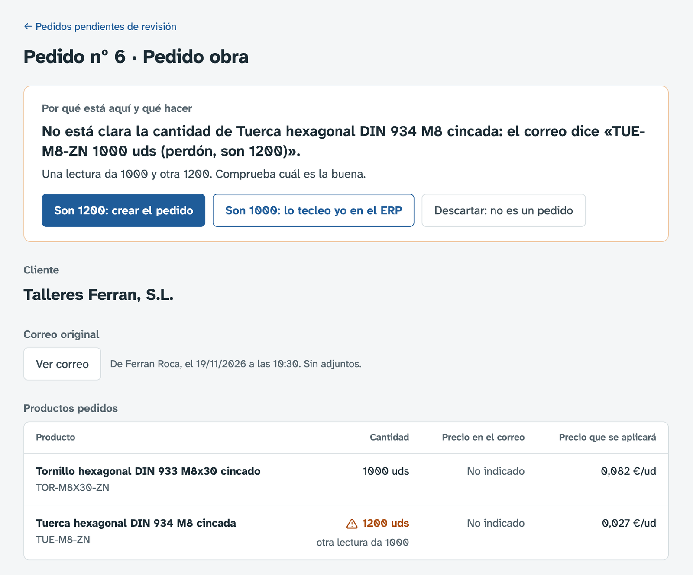

# El caso en una página

**Caso ficticio.** Orvalle Suministros Industriales, sus clientes y sus cifras son inventados. Es un proyecto de portfolio hecho con asistencia de IA ([cómo](../AI_USAGE.md)).

## El problema

Orvalle vende tornillería, guantes y herramienta a talleres y pequeñas fábricas. Recibe unos **1.800 pedidos al mes por correo**, cada uno a su manera: "ponme lo de siempre", un Excel propio, un PDF, medio en catalán.

Cuatro personas leen cada correo, adivinan qué producto es, comprueban el precio que se pactó y lo teclean. Son unos **6 minutos por pedido: 180 horas al mes, el 32 % de las 560 horas efectivas del equipo**. La empresa quiere crecer un 20 % sin contratar, y así no llega. *(Son cifras del escenario, no mediciones.)*

Teclear es lo lento, pero lo caro es **equivocarse**: mandar 1.000 tuercas cuando eran 1.200.

## La decisión clave

La tentación es dárselo todo a una IA. Aquí se reparte el trabajo en tres:

- **La IA lee.** Entiende un correo desordenado y saca de él una lista: qué, cuánto y a qué precio.
- **Las reglas deciden.** Comprueban lo que se puede comprobar: ¿conocemos a quien escribe?, ¿existe ese producto?, ¿es el precio pactado? La IA no acepta precios ni decide quién es el cliente. Tampoco cuenta lo segura que diga estar.
- **Una persona resuelve lo dudoso.** Lo ve en una pantalla, con el motivo en una frase y los botones que tocan.

Además, un segundo lector, más simple y sin IA, lee lo que puede. **Si los dos no coinciden, no se crea el pedido.** Por ejemplo, con "1000 uds (perdón, son 1200)", uno lee 1000 y el otro 1200, y la persona elige.

## Los resultados

Se probó con 20 correos, de tres maneras (v1.1):

| | Bien | Seguro, pero no lo esperado | Mal | Pedidos automáticos erróneos |
|---|---|---|---|---|
| Solo reglas | 7 | 5 | 8 | 8 de 11 |
| Solo IA | 19 | 1 | 0 | 0 de 12 |
| **Las dos juntas** | 16 | 4 | 0 | 0 de 9 |

- **Las reglas solas no valen:** dejan líneas fuera sin avisar.
- **La IA leyó muy bien,** tanto que en estos 20 casos el segundo lector no llegó a evitar ningún error y costó tres revisiones de más. Es el precio de un seguro, y con tan pocos casos no se sabe todavía si compensa.
- **El caso que salió mal en la v1** fue un cliente que corrige el *código* de un producto a mitad de línea: la IA no se aclaró. Con una regla nueva, la IA lo lee bien; con las dos juntas, el segundo lector no, y lo decide una persona.
- **Si la IA no responde,** el pedido llega a una persona con el motivo. Pasó con 15 casos en dos pruebas con el servicio saturado, y ninguno creó un pedido. El sistema todavía no lo reintenta solo más tarde.

El detalle está en los [resultados v1.1](../eval/resultados-v1-1.md), y los fallos de la primera versión, en los [resultados v1](../eval/resultados-v1.md). El vídeo muestra la v1.

## Los límites

- **Son 20 correos de desarrollo:** 7 sirvieron para construir el sistema y 13 se escribieron conociéndolo. No hay un examen guardado aparte. Las 13 respuestas correctas nuevas las revisó una segunda instancia de Claude que no las escribió, sin cambios; todavía no hay revisión humana. Con 0 errores en 9 pedidos automáticos, **el error real podría llegar a 1 de cada 3**. Para confiar harían falta cientos, en un piloto con el equipo.
- **Los 13 correos nuevos los escribió una IA,** y ninguno es de un cliente de verdad.
- **Faltan piezas:** distinguir un pedido de una consulta, detectar duplicados, comprobar cajas y unidades, leer PDF y enviar respuestas al cliente.
- **El ahorro no está demostrado.** Depende de cuánto se tarde en revisar cada pedido dudoso, y eso solo lo dice un piloto ([caso de negocio](02-business-case.md)).

**Lo que sí demuestra:** un sistema que sabe cuándo no sabe, y que dice con números hasta dónde llega.
