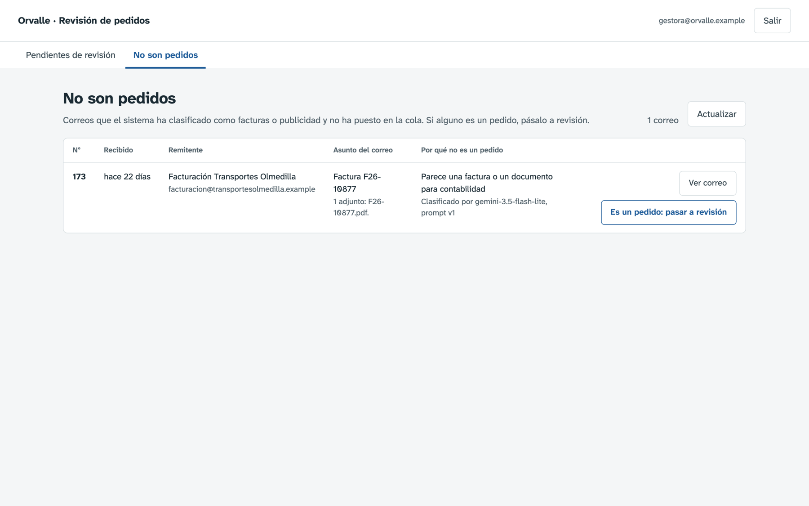
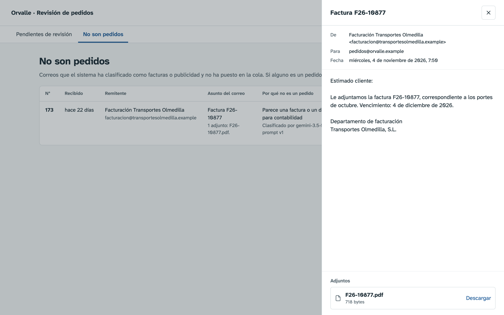
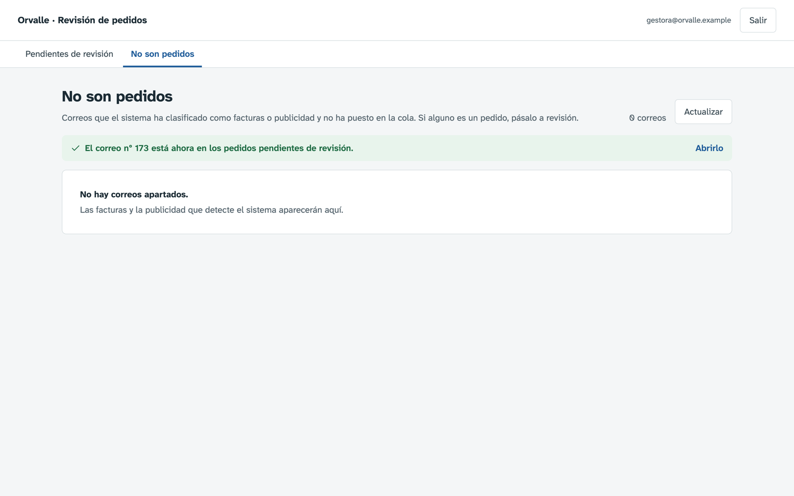
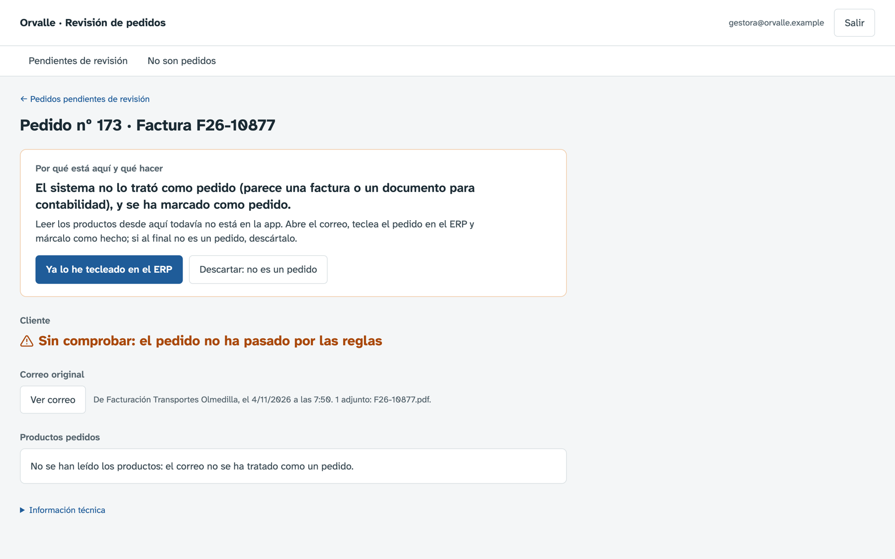
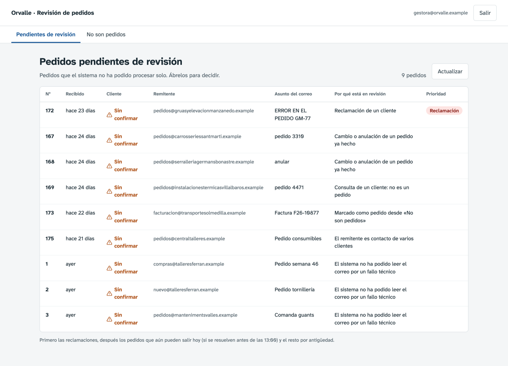

# Desarrollo v2: clasificación

**Los 20 correos de [desarrollo](../data/synthetic/evaluacion-v2/README.md), en el híbrido, con la clasificación integrada en el flujo. Pasada 1 el 25-11-2026; pasada 3, la limpia, el 26-11-2026. La prueba (60 casos, tag `prueba-v2.1`) no se ha ejecutado.**

## Resumen

**Pasada 3 (26-11-2026), limpia:** los 20 casos, sin ningún M03, con el mismo prompt, flujo y reglas que la pasada 1. Es la que se publica con el texto v1 del prompt de clasificación.

**Con el texto v2 (26-11-2026, el que se usa en la prueba), el mismo resultado caso a caso:** 20 de 20 tipos bien y 14 de 14 en alcance OK, sin M03 ([sección](#texto-v2-del-prompt-de-clasificación)).

| Qué | Pasada 3 | Pasada 1 (25-11) |
|---|---|---|
| Tipo de correo | **20 de 20 bien** | 19 de 19 bien; 1 sin clasificar (503) |
| Salida y motivos, casos en alcance (14) | **14 OK, 0 FALLO, 0 M03** | 12 OK, 0 FALLO, 2 M03 |
| Salida y motivos, casos fuera de alcance (6) | 6 FALLO | 5 FALLO, 1 M03 |
| Pedidos automáticos en alcance | 4, con sus líneas bien. Con 4 casos no se puede decir nada de la tasa de error: la regla del 3 da 3/4 | Los mismos 4 |
| Automáticos indebidos fuera de alcance | 4: D03, D05, D09 y D10 | Los mismos 4 |

- **R11 ya está medido:** D04 y D11, los dos casos de precio, van a revisión con R11. En la pasada 1 acabaron en M03.
- **Los 6 FALLO son de reglas que no existen:** R03 (D12 y D13), R06 (D03), R09 (D09), M04 (D10) y varios pedidos en un correo (D05). Ninguno es de la clasificación. D12 es nuevo como FALLO porque en la pasada 1 fue M03: sin R03, va a revisión con R02, como D13.
- **Los 4 automáticos indebidos no son inocuos.** Es lo que haría el sistema hoy: crear un pedido con un producto descatalogado, con entrega en festivo, con dos pedidos juntos o con una orden escondida en una celda. Es la medida de lo que cuestan las reglas que faltan.
- **D20, la factura, se deriva** y ahora se ve en la lista "No son pedidos" de la app. Se usó para probar el botón "Es un pedido: pasar a revisión" ([capturas](#d20-en-la-app)).

## Qué se ajustó

**Con los 20 de desarrollo v2, nada.** El prompt de clasificación se escribió desde [04](../docs/04-solution-design.md), y en esos 20 casos no hubo ningún error que motivara un cambio. **Con los 20 de la v1, que también son desarrollo, un ajuste:** el texto v2 (abajo), por 15 y 16. La versión 2 es el mismo texto que la 1 con otro modelo:

| Versión | Texto | Hash | Modelo | Por qué |
|---|---|---|---|---|
| 1 | v1 | `c761b231b9f4` | `gemini-3.1-flash-lite` | El del [ADR 0005](../docs/decisions/0005-modelo-de-ia.md) |
| 2 | v1 | `be628fae8dfd` | `gemini-3.5-flash-lite` | El 3.1 respondió 503 en 20 de 20 casos y en 12 sondas a lo largo de 35 min. Lo motivó la disponibilidad, no un resultado |
| 3 | v2, borrador | `7f955db97971` | `gemini-3.5-flash-lite` | La regla de abajo, metida dentro de la lista de tipos. Descartado tras el code review: la lista quedaba partida |
| 4, activa | v2 | `3fb185e49636` | `gemini-3.5-flash-lite` | 15 y 16 de la v1 ([regresión](regresion-v2.md#2-con-la-clasificación-puesta)) |

## Texto v2 del prompt de clasificación

**26-11-2026, antes de ejecutar la prueba, ajustado solo con desarrollo** (los 20 de aquí y los 20 de la v1). En la regresión, 15 y 16, dos pedidos que se corrigen a sí mismos, salían como `modificacion_anulacion`. Es una regla general, no una lista de casos:

- `modificacion_anulacion`: cambia o anula un pedido enviado antes, en otro correo, y se refiere a él por su número, su fecha o una cita de su confirmación.
- Un correo que pide material y corrige un dato de ese mismo pedido dentro del propio correo es `pedido_nuevo`. Los ejemplos del prompt ("perdón, es…", "en el adjunto pone 500, pero son 800") son frases genéricas, no las de 15 y 16.

**Se comprobó en los dos sentidos:**

| Qué | Texto v1 (pasada 3 y regresión, sección 2) | Texto v2 |
|---|---|---|
| 15 y 16 de la v1 | `modificacion_anulacion` en el híbrido | **`pedido_nuevo`** en solo IA y en el híbrido |
| D15 y D16, las dos modificaciones de desarrollo | `modificacion_anulacion` | **`modificacion_anulacion`**: ninguna pasa a pedido |
| Los 20 de desarrollo | 20 de 20 tipos bien | **20 de 20 tipos bien**; salidas idénticas a la pasada 3 |
| Los 20 de la v1, iguales a la v1.1 | 17 de 20 (solo el híbrido) | **58 de 60, en las tres configuraciones**: solo cambia el 20, esperado ([regresión, sección 3](regresion-v2.md#3-con-el-texto-v2-de-la-clasificación)) |

Pasada de desarrollo con el texto v2: entera, sin M03 ni 429, 10 s de pausa; 540 tokens de entrada de media por clasificación (453 con el v1) y 22 de salida. Guardada en [desarrollo-v2-prompt-v4.jsonl](ejecuciones/desarrollo-v2-prompt-v4.jsonl). La del borrador, con el mismo resultado caso a caso, en [desarrollo-v2-prompt-v3-borrador.jsonl](ejecuciones/desarrollo-v2-prompt-v3-borrador.jsonl); su regresión dio lo mismo que la del texto v2 (58 de 60, solo el 20).

**Lo que no se sabe:** desarrollo solo tiene dos modificaciones, y las dos citan el pedido (número o "B-74 del viernes"). Una modificación que no lo identifica ("anulad lo último que os pedí") no está en desarrollo; con el texto v2 debería ir a `dudoso` o a `modificacion_anulacion`, y no se ha medido.

**Que los 20 salgan bien no demuestra que la clasificación sea buena.** Son correos cortos y claros; el prompt y los correos los escribió el mismo modelo, que ya conocía los 80; y solo hay una reclamación y un "otros". Los casos difíciles (la reclamación con pedido, la consulta que casi es un pedido, el phishing) están solo en la prueba.

## Llamadas y cuota

- Media por clasificación: 451 tokens de entrada y 22 de salida en la pasada 1; 453 y 22 en la 3.
- **Los dos prompts están ahora en el mismo modelo y comparten 500 peticiones al día.** El reparto del ADR 0005 ya no existe. La prueba completa (unas 120 clasificaciones y unas 90 extracciones, sin reintentos) cabe en un día si ese día no se hace mucho más.
- A las 19:58, Gemini respondió `429 · limit: 500 requests per day`, y se paró. Los reintentos del nodo (hasta 3 por fallo) también gastan.

| Ejecución | Qué pasó | Guardada en |
|---|---|---|
| 0, con el 3.1 | 20 de 20 en M03 (503). El evaluador no paraba solo; ahora para al tercer fallo seguido | [pasada0-503](ejecuciones/desarrollo-v2-pasada0-503.jsonl) |
| 1, con el 3.5 | Primera completa, con 3 M03 | [pasada1](ejecuciones/desarrollo-v2-pasada1.jsonl) |
| 2, con el 3.5 | Parada en el cuarto caso: cuota agotada | [pasada2-parada](ejecuciones/desarrollo-v2-pasada2-parada.jsonl) |
| 3, con el 3.5 | Entera, sin M03 ni 429, con 10 s de pausa. **La que se publica** | [pasada3](ejecuciones/desarrollo-v2-pasada3.jsonl) |

En la pasada 1, el evaluador ponía M03 también al tipo cuando fallaba solo la extracción. Se corrigió después, y las notas de D04 y D12 se recalcularon desde lo guardado, sin volver a llamar a Gemini.

## Repetición tras la cuota

Si una pasada tiene un M03 por 503 o 429, se repite **entera** más tarde, nunca solo los casos fallidos: así cada pasada publicada es una sola ejecución con el mismo estado del servicio. La pasada 3 no lo necesitó. La regresión de la v1.1 con la clasificación está en [regresion-v2.md](regresion-v2.md), sección 2.

## Caso a caso

Pasada 3.

| Caso | Tipo etiquetado | Tipo leído | Salida etiquetada | Salida | Nota | Depende de |
|---|---|---|---|---|---|---|
| D01 | pedido_nuevo | pedido_nuevo | automatico | automatico | OK | — |
| D02 | pedido_nuevo | pedido_nuevo | automatico | automatico | OK | — |
| D03 | pedido_nuevo | pedido_nuevo | pedir datos R06 | automatico | FALLO | R06 |
| D04 | pedido_nuevo | pedido_nuevo | revision R11 | revision R11 | OK | — |
| D05 | pedido_nuevo | pedido_nuevo | revision | automatico | FALLO | D16 |
| D06 | pedido_nuevo | pedido_nuevo | revision R02 | revision R02 | OK | — |
| D07 | pedido_nuevo | pedido_nuevo | automatico | automatico | OK | — |
| D08 | pedido_nuevo | pedido_nuevo | automatico | automatico | OK | — |
| D09 | pedido_nuevo | pedido_nuevo | revision R09 | automatico | FALLO | R09 |
| D10 | pedido_nuevo | pedido_nuevo | revision M04 | automatico | FALLO | M04 |
| D11 | pedido_nuevo | pedido_nuevo | revision R11 | revision R11 | OK | — |
| D12 | pedido_nuevo | pedido_nuevo | automatico | revision R02 | FALLO | R03 |
| D13 | pedido_nuevo | pedido_nuevo | automatico | revision R02 | FALLO | R03 |
| D14 | pedido_nuevo | pedido_nuevo | revision M02 | revision M02 | OK | — |
| D15 | modificacion_anulacion | modificacion_anulacion | revision R01 | revision R01 | OK | — |
| D16 | modificacion_anulacion | modificacion_anulacion | revision R01 | revision R01 | OK | — |
| D17 | consulta | consulta | revision R01 | revision R01 | OK | — |
| D18 | consulta | consulta | revision R01 | revision R01 | OK | — |
| D19 | reclamacion | reclamacion | revision R01 | revision R01 | OK | — |
| D20 | otros | otros | derivado | derivado | OK | — |

## Limitaciones

- Una pasada limpia, una configuración y 20 casos que conocía quien escribió el prompt.
- Las etiquetas no tienen revisión humana.
- Un pedido clasificado como `otros` no llega a la cola: es el error caro de esta pieza, y con un solo "otros" no se ha medido. Desde el 26-11 no desaparece: se ve en "No son pedidos", pero solo si alguien mira esa lista.
- Solo reglas no clasifica, y solo IA no se ha pasado: usa la misma clasificación que el híbrido.

## D20 en la app

El caso de D20 de la pasada 3 (nº 173 en la base local), derivado a contabilidad, en la lista "No son pedidos" y después de pulsar "Es un pedido: pasar a revisión". Sesión de la gestora de ADV, 26-11-2026.

| | |
|---|---|
|  |  |
|  |  |

