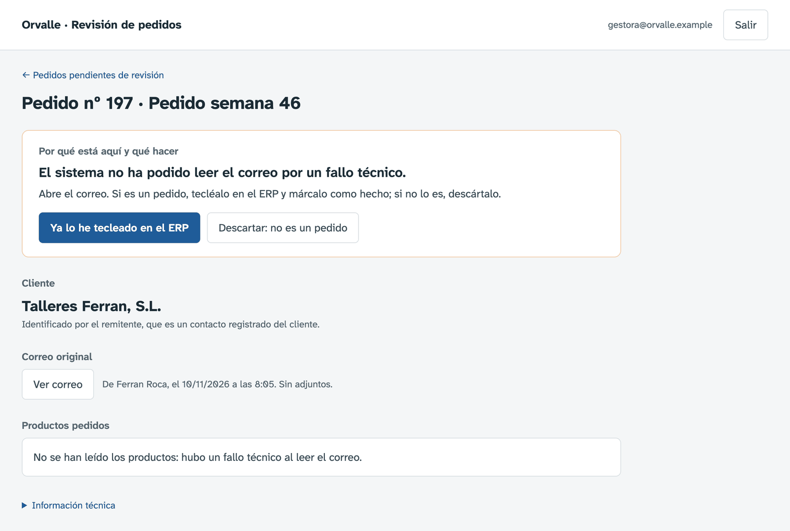

# Resultados de la evaluación v1.1

**Los mismos 20 correos que en la [v1](resultados-v1.md), con las mismas etiquetas.** Siguen siendo casos de desarrollo: sirven para ver qué hace el sistema y dónde falla, no para estimar su tasa de error. 25-11-2026.

## Qué cambió

1. **Prompt de extracción v3:** una regla nueva, "Si el cliente corrige un dato, devuelve solo el corregido". La motivó el [caso 16](resultados-v1.md#los-fallos-uno-a-uno).
2. **Si falla la IA, el caso va a la cola con M03** (fallo técnico), en lugar de parar el flujo.

## Resumen

Es la pasada 3, la **pasada limpia**: las tres configuraciones de una vez y ningún caso en M03 (ver [qué pasada se publica](#qué-pasada-se-publica)).

| Configuración | OK | ACEPTABLE | FALLO | M03 (servicio caído) | Pedidos automáticos | Automáticos erróneos o indebidos |
|---|---|---|---|---|---|---|
| Solo reglas | 7 | 5 | 8 | 0 | 11 | **8** |
| Solo IA | 19 | 1 | 0 | 0 | 12 | **0** |
| Híbrido | 16 | 4 | 0 | 0 | 9 | **0** |

En la v1:

| Configuración | OK | ACEPTABLE | FALLO | M03 (servicio caído) | Pedidos automáticos | Automáticos erróneos o indebidos |
|---|---|---|---|---|---|---|
| Solo reglas | 7 | 5 | 8 | 0 | 11 | **8** |
| Solo IA | 18 | 1 | 1 | 0 | 11 | **0** |
| Híbrido | 16 | 3 | 1 | 0 | 9 | **0** |

OK, ACEPTABLE y FALLO significan lo mismo que en la [v1](resultados-v1.md#resumen). M03 va en su propia columna: el servicio no respondió, y el caso llegó a una persona.

## Qué se puede concluir

1. **El caso 16 ya no falla.** Con solo IA crea el pedido correcto (TUE-M10-ZN × 400). En el híbrido va a revisión solo con R12, porque el determinista sigue leyendo el código sin corregir: es ACEPTABLE. Ha salido igual en las tres pasadas.
2. **Es el único cambio.** Los demás casos salen como en la v1 en las tres configuraciones.
3. **"Solo IA" sigue saliendo mejor que el híbrido:** 06, 15 y 16 son tres revisiones que no hacían falta, y R12 no evitó ningún pedido equivocado. Lo dicho en la [v1](resultados-v1.md#qué-se-puede-concluir) sobre esa red se mantiene.

## Comparación con la v1, caso a caso

v1 → v1.1. "Igual" quiere decir misma nota, misma salida y mismos motivos.

| Correo | Solo reglas | Solo IA | Híbrido |
|---|---|---|---|
| 01-automatico | igual: **FALLO** · automático | igual: OK · automático | igual: OK · automático |
| 02-remitente-desconocido | igual: OK · revisión R02 | igual: OK · revisión R02 | igual: OK · revisión R02 |
| 03-precio-distinto | igual: **FALLO** · automático | igual: OK · revisión R11 | igual: OK · revisión R11 |
| 04-excel-xlsx | igual: OK · automático | igual: OK · automático | igual: OK · automático |
| 05-excel-xls | igual: OK · revisión M02 | igual: OK · revisión M02 | igual: OK · revisión M02 |
| 06-discrepancia | igual: **FALLO** · automático | igual: OK · automático | igual: ACEPTABLE · revisión R12 |
| 07-adjunto-sin-adjunto | igual: ACEPTABLE · revisión M01 | igual: ACEPTABLE · revisión M01 | igual: ACEPTABLE · revisión M01 |
| 08-texto-catalan | igual: OK · automático | igual: OK · automático | igual: OK · automático |
| 09-equivalencias | igual: ACEPTABLE · revisión M01 | igual: OK · automático | igual: OK · automático |
| 10-punto-de-miles | igual: **FALLO** · automático | igual: OK · automático | igual: OK · automático |
| 11-multiplicacion | igual: **FALLO** · automático | igual: OK · automático | igual: OK · automático |
| 12-excel-con-precios | igual: OK · automático | igual: OK · automático | igual: OK · automático |
| 13-excel-cabeceras-raras | igual: ACEPTABLE · revisión M01 | igual: OK · automático | igual: OK · automático |
| 14-excel-unidad-en-celda | igual: **FALLO** · automático | igual: OK · automático | igual: OK · automático |
| 15-discrepancia-excel-cuerpo | igual: **FALLO** · automático | igual: OK · automático | igual: ACEPTABLE · revisión R12 |
| 16-discrepancia-codigo | igual: **FALLO** · automático | **FALLO** · pedir datos R08 → OK · automático | **FALLO** · revisión R08, R12 → ACEPTABLE · revisión R12 |
| 17-solo-descripcion | igual: ACEPTABLE · revisión M01 | igual: OK · revisión R08 | igual: OK · revisión R08 |
| 18-codigo-inexistente | igual: ACEPTABLE · revisión M01 | igual: OK · pedir datos R08 | igual: OK · pedir datos R08 |
| 19-pdf | igual: OK · revisión M02 | igual: OK · revisión M02 | igual: OK · revisión M02 |
| 20-consulta-sin-cantidad | igual: OK · revisión M01 | igual: OK · revisión M01 | igual: OK · revisión M01 |

## Qué pasada se publica

**La regla:** la cabecera es una pasada limpia, es decir, los 20 casos en las tres configuraciones sin que ningún caso acabe en M03. Antes se comprueba con una sola petición que Gemini responde. Si una pasada no es limpia, se anota y se repite entera, hasta tres intentos; nunca se repiten solo los casos que fallaron. Si ninguna lo es, se sigue publicando la v1.

**Por qué se cambió.** Las dos primeras pasadas coincidieron con Gemini saturado, y la regla de entonces era publicar la segunda, saliera lo que saliera. Esa tabla mezclaba dos cosas: cómo lee el sistema y si el servicio estaba disponible. El autor pidió separarlas antes de publicar, con los resultados de las dos pasadas ya a la vista. La regla nueva se fijó antes de ejecutar la pasada 3, que fue limpia a la primera.

**Lo que no se puede asegurar:** que en la pasada 3 no hubiera ningún 503. El nodo reintenta hasta tres veces y no guarda los intentos fallidos. De los 36 casos con IA, 15 tardaron más de 7 s y el resto menos de 5, lo que apunta a reintentos que acabaron respondiendo. Un reintento no cambia lo que se lee ni cómo se evalúa.

## Comportamiento con Gemini caído

Las pasadas 1 y 2, con el mismo sistema y Gemini saturado (503). Solo reglas no usa la IA y salió como en la v1.

- **15 casos acabaron en M03** de los 72 que llaman a la IA: 10 en la pasada 1 y 5 en la 2.
- **Ninguno creó un pedido,** así que ninguno creó uno erróneo. Tampoco hubo ningún pedido erróneo en los demás casos con IA.
- **Los 15 llegaron a la cola:** están en `en_revision` con M03 abierto, comprobado en la base de datos.
- **Cuando Gemini contestó, no hubo ningún FALLO.**

Pasada 1:

| Configuración | OK | ACEPTABLE | FALLO | M03 (servicio caído) | Pedidos automáticos | Automáticos erróneos o indebidos |
|---|---|---|---|---|---|---|
| Solo IA | 17 | 1 | 0 | 2 | 10 | **0** |
| Híbrido | 10 | 2 | 0 | 8 | 5 | **0** |

Pasada 2:

| Configuración | OK | ACEPTABLE | FALLO | M03 (servicio caído) | Pedidos automáticos | Automáticos erróneos o indebidos |
|---|---|---|---|---|---|---|
| Solo IA | 15 | 1 | 0 | 4 | 9 | **0** |
| Híbrido | 15 | 4 | 0 | 1 | 8 | **0** |

En la pasada 1, `enviar_eml.py` esperaba 120 s y el flujo puede tardar unos 190 s en agotar los tres intentos: en el caso 07 del híbrido el script se cortó, y su resultado (M03) se ha leído de la base de datos. Después, la espera es de 240 s.

| Correo | Pasada 1, solo IA | Pasada 1, híbrido | Pasada 2, solo IA | Pasada 2, híbrido |
|---|---|---|---|---|
| 01-automatico | OK · automático | OK · automático | OK · automático | OK · automático |
| 02-remitente-desconocido | OK · revisión R02 | OK · revisión R02 | OK · revisión R02 | OK · revisión R02 |
| 03-precio-distinto | OK · revisión R11 | M03 | M03 | OK · revisión R11 |
| 04-excel-xlsx | M03 | OK · automático | OK · automático | OK · automático |
| 05-excel-xls | OK · revisión M02 | OK · revisión M02 | OK · revisión M02 | OK · revisión M02 |
| 06-discrepancia | OK · automático | ACEPTABLE · revisión R12 | OK · automático | ACEPTABLE · revisión R12 |
| 07-adjunto-sin-adjunto | ACEPTABLE · revisión M01 | M03 | ACEPTABLE · revisión M01 | ACEPTABLE · revisión M01 |
| 08-texto-catalan | OK · automático | M03 | M03 | OK · automático |
| 09-equivalencias | OK · automático | OK · automático | M03 | OK · automático |
| 10-punto-de-miles | OK · automático | M03 | OK · automático | OK · automático |
| 11-multiplicacion | M03 | OK · automático | OK · automático | OK · automático |
| 12-excel-con-precios | OK · automático | M03 | M03 | M03 |
| 13-excel-cabeceras-raras | OK · automático | OK · automático | OK · automático | OK · automático |
| 14-excel-unidad-en-celda | OK · automático | M03 | OK · automático | OK · automático |
| 15-discrepancia-excel-cuerpo | OK · automático | M03 | OK · automático | ACEPTABLE · revisión R12 |
| 16-discrepancia-codigo | OK · automático | ACEPTABLE · revisión R12 | OK · automático | ACEPTABLE · revisión R12 |
| 17-solo-descripcion | OK · revisión R08 | M03 | OK · revisión R08 | OK · revisión R08 |
| 18-codigo-inexistente | OK · pedir datos R08 | OK · pedir datos R08 | OK · pedir datos R08 | OK · pedir datos R08 |
| 19-pdf | OK · revisión M02 | OK · revisión M02 | OK · revisión M02 | OK · revisión M02 |
| 20-consulta-sin-cantidad | OK · revisión M01 | OK · revisión M01 | OK · revisión M01 | OK · revisión M01 |

En las salidas del script, al final, un M03 aparece como FALLO: las etiquetas no lo prevén y no se han cambiado.

## Prueba de M03

Con el correo 01 y un fallo forzado cada vez. Los siete casos quedaron en `en_revision` con M03 abierto, y la cola de la app los devuelve.

| Fallo | Cómo se forzó | Configuración |
|---|---|---|
| Modelo inexistente (404 real de Gemini) | Versión de prompt temporal, ya borrada | Solo IA e híbrido |
| Error HTTP 500 | Servidor local en lugar de Gemini | Híbrido |
| Tiempo agotado | Igual, con un límite de 3 s | Híbrido |
| Respuesta sin `model_output` | Igual | Híbrido |
| `model_output` que no es JSON | Igual | Híbrido |
| JSON que no cumple el esquema | Igual | Solo IA |

Con el modelo inexistente, solo reglas siguió creando su pedido: no llama a la IA.

Así lo ve la gestora:



## Limitaciones

Las de la [v1](resultados-v1.md#limitaciones), y además:

- **La regla nueva salió de un caso de este mismo conjunto.** Que el 16 mejore es lo esperable, no una prueba de que generalice.
- **Con 0 errores, la regla del 3 da** 3/12 = 25 % en solo IA y 3/9 ≈ 33 % en el híbrido.
- **La cabecera mide la lectura, no la disponibilidad.** Con el servicio saturado, más casos van a una persona: 5 y 10 en las pasadas anteriores.
- **M03 no reintenta más tarde ni distingue una caída general de un caso raro.** El diseño ([04, sección 2.6](../docs/04-solution-design.md#26-fallos-técnicos-caída-general-y-modo-manual)) sí lo prevé. Una respuesta no válida tampoco se reintenta.

## Cómo se ejecutó

- **Sistema:** modelo `gemini-3.5-flash-lite`; prompt `extraccion` con hash `ea73c9fd7c06…`; extractor determinista 0.1.1. El prompt, el flujo y las reglas no cambiaron entre las tres pasadas. En la 3, 36 llamadas a la IA contestadas, con 321 tokens de entrada y 131 de salida de media.
- **Versión del prompt:** "v3" es su tercera versión en la historia del repo. En la base local, reiniciada para la demo, es la 2: lo que identifica a un prompt es su hash.
- **Comando:** el de la [v1](resultados-v1.md#cómo-se-ejecutó), sin reiniciar la base, con `--nuevos`.

<details>
<summary>Salida de <code>scripts/enviar_eml.py</code>, pasada 3 (la publicada)</summary>

```
Configuración: solo_reglas
01-automatico.eml                caso  499  automatico  pedido  167  motivos -  FALLO: faltan TOR-M8X30-ZN x1000
02-remitente-desconocido.eml     caso  500  revision    pedido    -  motivos R02  OK
03-precio-distinto.eml           caso  501  automatico  pedido  168  motivos -  FALLO: salida automatico, esperada revision; motivos -, esperados R11
Configuración: solo_reglas
04-excel-xlsx.eml                caso  502  automatico  pedido  169  motivos -  OK
05-excel-xls.eml                 caso  503  revision    pedido    -  motivos M02  OK
06-discrepancia.eml              caso  504  automatico  pedido  170  motivos -  FALLO: faltan TUE-M8-ZN x1200; sobran TUE-M8-ZN x1000
07-adjunto-sin-adjunto.eml       caso  505  revision    pedido    -  motivos M01  ACEPTABLE (salida segura; esperado pedir_datos)
Configuración: solo_reglas
08-texto-catalan.eml             caso  506  automatico  pedido  171  motivos -  OK
09-equivalencias.eml             caso  507  revision    pedido    -  motivos M01  ACEPTABLE (salida segura; esperado automatico)
10-punto-de-miles.eml            caso  508  automatico  pedido  172  motivos -  FALLO: faltan TOR-M8X30-ZN x1000
11-multiplicacion.eml            caso  509  automatico  pedido  173  motivos -  FALLO: faltan TOR-M10X40-ZN x1000
12-excel-con-precios.eml         caso  510  automatico  pedido  174  motivos -  OK
13-excel-cabeceras-raras.eml     caso  511  revision    pedido    -  motivos M01  ACEPTABLE (salida segura; esperado automatico)
14-excel-unidad-en-celda.eml     caso  512  automatico  pedido  175  motivos -  FALLO: faltan TOR-M8X30-ZN x200
15-discrepancia-excel-cuerpo.eml caso  513  automatico  pedido  176  motivos -  FALLO: faltan TUE-M8-ZN x800; sobran TUE-M8-ZN x500
16-discrepancia-codigo.eml       caso  514  automatico  pedido  177  motivos -  FALLO: faltan TUE-M10-ZN x400; sobran TUE-M8-ZN x400
17-solo-descripcion.eml          caso  515  revision    pedido    -  motivos M01  ACEPTABLE (salida segura; esperado revision)
18-codigo-inexistente.eml        caso  516  revision    pedido    -  motivos M01  ACEPTABLE (salida segura; esperado pedir_datos)
19-pdf.eml                       caso  517  revision    pedido    -  motivos M02  OK
20-consulta-sin-cantidad.eml     caso  518  revision    pedido    -  motivos M01  OK
Configuración: solo_ia
01-automatico.eml                caso  519  automatico  pedido  178  motivos -  OK
02-remitente-desconocido.eml     caso  520  revision    pedido    -  motivos R02  OK
03-precio-distinto.eml           caso  521  revision    pedido    -  motivos R11  OK
Configuración: solo_ia
04-excel-xlsx.eml                caso  522  automatico  pedido  179  motivos -  OK
05-excel-xls.eml                 caso  523  revision    pedido    -  motivos M02  OK
06-discrepancia.eml              caso  524  automatico  pedido  180  motivos -  OK
07-adjunto-sin-adjunto.eml       caso  525  revision    pedido    -  motivos M01  ACEPTABLE (salida segura; esperado pedir_datos)
Configuración: solo_ia
08-texto-catalan.eml             caso  526  automatico  pedido  181  motivos -  OK
09-equivalencias.eml             caso  527  automatico  pedido  182  motivos -  OK
10-punto-de-miles.eml            caso  528  automatico  pedido  183  motivos -  OK
11-multiplicacion.eml            caso  529  automatico  pedido  184  motivos -  OK
12-excel-con-precios.eml         caso  530  automatico  pedido  185  motivos -  OK
13-excel-cabeceras-raras.eml     caso  531  automatico  pedido  186  motivos -  OK
14-excel-unidad-en-celda.eml     caso  532  automatico  pedido  187  motivos -  OK
15-discrepancia-excel-cuerpo.eml caso  533  automatico  pedido  188  motivos -  OK
16-discrepancia-codigo.eml       caso  534  automatico  pedido  189  motivos -  OK
17-solo-descripcion.eml          caso  535  revision    pedido    -  motivos R08  OK
18-codigo-inexistente.eml        caso  536  pedir_datos pedido    -  motivos R08  OK
19-pdf.eml                       caso  537  revision    pedido    -  motivos M02  OK
20-consulta-sin-cantidad.eml     caso  538  revision    pedido    -  motivos M01  OK
Configuración: hibrido
01-automatico.eml                caso  539  automatico  pedido  190  motivos -  OK
02-remitente-desconocido.eml     caso  540  revision    pedido    -  motivos R02  OK
03-precio-distinto.eml           caso  541  revision    pedido    -  motivos R11  OK
Configuración: hibrido
04-excel-xlsx.eml                caso  542  automatico  pedido  191  motivos -  OK
05-excel-xls.eml                 caso  543  revision    pedido    -  motivos M02  OK
06-discrepancia.eml              caso  544  revision    pedido    -  motivos R12  ACEPTABLE (salida segura; esperado automatico)
07-adjunto-sin-adjunto.eml       caso  545  revision    pedido    -  motivos M01  ACEPTABLE (salida segura; esperado pedir_datos)
Configuración: hibrido
08-texto-catalan.eml             caso  546  automatico  pedido  192  motivos -  OK
09-equivalencias.eml             caso  547  automatico  pedido  193  motivos -  OK
10-punto-de-miles.eml            caso  548  automatico  pedido  194  motivos -  OK
11-multiplicacion.eml            caso  549  automatico  pedido  195  motivos -  OK
12-excel-con-precios.eml         caso  550  automatico  pedido  196  motivos -  OK
13-excel-cabeceras-raras.eml     caso  551  automatico  pedido  197  motivos -  OK
14-excel-unidad-en-celda.eml     caso  552  automatico  pedido  198  motivos -  OK
15-discrepancia-excel-cuerpo.eml caso  553  revision    pedido    -  motivos R12  ACEPTABLE (salida segura; esperado automatico)
16-discrepancia-codigo.eml       caso  554  revision    pedido    -  motivos R12  ACEPTABLE (salida segura; esperado automatico)
17-solo-descripcion.eml          caso  555  revision    pedido    -  motivos R08  OK
18-codigo-inexistente.eml        caso  556  pedir_datos pedido    -  motivos R08  OK
19-pdf.eml                       caso  557  revision    pedido    -  motivos M02  OK
20-consulta-sin-cantidad.eml     caso  558  revision    pedido    -  motivos M01  OK
```

</details>

<details>
<summary>Salida de <code>scripts/enviar_eml.py</code>, pasada 2</summary>

```
Configuración: solo_reglas
01-automatico.eml                caso  349  automatico  pedido  113  motivos -  FALLO: faltan TOR-M8X30-ZN x1000
02-remitente-desconocido.eml     caso  350  revision    pedido    -  motivos R02  OK
03-precio-distinto.eml           caso  351  automatico  pedido  114  motivos -  FALLO: salida automatico, esperada revision; motivos -, esperados R11
Configuración: solo_reglas
04-excel-xlsx.eml                caso  352  automatico  pedido  115  motivos -  OK
05-excel-xls.eml                 caso  353  revision    pedido    -  motivos M02  OK
06-discrepancia.eml              caso  354  automatico  pedido  116  motivos -  FALLO: faltan TUE-M8-ZN x1200; sobran TUE-M8-ZN x1000
07-adjunto-sin-adjunto.eml       caso  355  revision    pedido    -  motivos M01  ACEPTABLE (salida segura; esperado pedir_datos)
Configuración: solo_reglas
08-texto-catalan.eml             caso  356  automatico  pedido  117  motivos -  OK
09-equivalencias.eml             caso  357  revision    pedido    -  motivos M01  ACEPTABLE (salida segura; esperado automatico)
10-punto-de-miles.eml            caso  358  automatico  pedido  118  motivos -  FALLO: faltan TOR-M8X30-ZN x1000
11-multiplicacion.eml            caso  359  automatico  pedido  119  motivos -  FALLO: faltan TOR-M10X40-ZN x1000
12-excel-con-precios.eml         caso  360  automatico  pedido  120  motivos -  OK
13-excel-cabeceras-raras.eml     caso  361  revision    pedido    -  motivos M01  ACEPTABLE (salida segura; esperado automatico)
14-excel-unidad-en-celda.eml     caso  362  automatico  pedido  121  motivos -  FALLO: faltan TOR-M8X30-ZN x200
15-discrepancia-excel-cuerpo.eml caso  363  automatico  pedido  122  motivos -  FALLO: faltan TUE-M8-ZN x800; sobran TUE-M8-ZN x500
16-discrepancia-codigo.eml       caso  364  automatico  pedido  123  motivos -  FALLO: faltan TUE-M10-ZN x400; sobran TUE-M8-ZN x400
17-solo-descripcion.eml          caso  365  revision    pedido    -  motivos M01  ACEPTABLE (salida segura; esperado revision)
18-codigo-inexistente.eml        caso  366  revision    pedido    -  motivos M01  ACEPTABLE (salida segura; esperado pedir_datos)
19-pdf.eml                       caso  367  revision    pedido    -  motivos M02  OK
20-consulta-sin-cantidad.eml     caso  368  revision    pedido    -  motivos M01  OK
Configuración: solo_ia
01-automatico.eml                caso  369  automatico  pedido  124  motivos -  OK
02-remitente-desconocido.eml     caso  370  revision    pedido    -  motivos R02  OK
03-precio-distinto.eml           caso  371  revision    pedido    -  motivos M03  FALLO: motivos M03, esperados R11
Configuración: solo_ia
04-excel-xlsx.eml                caso  372  automatico  pedido  125  motivos -  OK
05-excel-xls.eml                 caso  373  revision    pedido    -  motivos M02  OK
06-discrepancia.eml              caso  374  automatico  pedido  126  motivos -  OK
07-adjunto-sin-adjunto.eml       caso  375  revision    pedido    -  motivos M01  ACEPTABLE (salida segura; esperado pedir_datos)
Configuración: solo_ia
08-texto-catalan.eml             caso  376  revision    pedido    -  motivos M03  FALLO: salida revision, esperada automatico; motivos M03, esperados -
09-equivalencias.eml             caso  377  revision    pedido    -  motivos M03  FALLO: salida revision, esperada automatico; motivos M03, esperados -
10-punto-de-miles.eml            caso  378  automatico  pedido  127  motivos -  OK
11-multiplicacion.eml            caso  379  automatico  pedido  128  motivos -  OK
12-excel-con-precios.eml         caso  380  revision    pedido    -  motivos M03  FALLO: salida revision, esperada automatico; motivos M03, esperados -
13-excel-cabeceras-raras.eml     caso  381  automatico  pedido  129  motivos -  OK
14-excel-unidad-en-celda.eml     caso  382  automatico  pedido  130  motivos -  OK
15-discrepancia-excel-cuerpo.eml caso  383  automatico  pedido  131  motivos -  OK
16-discrepancia-codigo.eml       caso  384  automatico  pedido  132  motivos -  OK
17-solo-descripcion.eml          caso  385  revision    pedido    -  motivos R08  OK
18-codigo-inexistente.eml        caso  386  pedir_datos pedido    -  motivos R08  OK
19-pdf.eml                       caso  387  revision    pedido    -  motivos M02  OK
20-consulta-sin-cantidad.eml     caso  388  revision    pedido    -  motivos M01  OK
Configuración: hibrido
01-automatico.eml                caso  389  automatico  pedido  133  motivos -  OK
02-remitente-desconocido.eml     caso  390  revision    pedido    -  motivos R02  OK
03-precio-distinto.eml           caso  391  revision    pedido    -  motivos R11  OK
Configuración: hibrido
04-excel-xlsx.eml                caso  392  automatico  pedido  134  motivos -  OK
05-excel-xls.eml                 caso  393  revision    pedido    -  motivos M02  OK
06-discrepancia.eml              caso  394  revision    pedido    -  motivos R12  ACEPTABLE (salida segura; esperado automatico)
07-adjunto-sin-adjunto.eml       caso  395  revision    pedido    -  motivos M01  ACEPTABLE (salida segura; esperado pedir_datos)
Configuración: hibrido
08-texto-catalan.eml             caso  396  automatico  pedido  135  motivos -  OK
09-equivalencias.eml             caso  397  automatico  pedido  136  motivos -  OK
10-punto-de-miles.eml            caso  398  automatico  pedido  137  motivos -  OK
11-multiplicacion.eml            caso  399  automatico  pedido  138  motivos -  OK
12-excel-con-precios.eml         caso  400  revision    pedido    -  motivos M03  FALLO: salida revision, esperada automatico; motivos M03, esperados -
13-excel-cabeceras-raras.eml     caso  401  automatico  pedido  139  motivos -  OK
14-excel-unidad-en-celda.eml     caso  402  automatico  pedido  140  motivos -  OK
15-discrepancia-excel-cuerpo.eml caso  403  revision    pedido    -  motivos R12  ACEPTABLE (salida segura; esperado automatico)
16-discrepancia-codigo.eml       caso  404  revision    pedido    -  motivos R12  ACEPTABLE (salida segura; esperado automatico)
17-solo-descripcion.eml          caso  405  revision    pedido    -  motivos R08  OK
18-codigo-inexistente.eml        caso  406  pedir_datos pedido    -  motivos R08  OK
19-pdf.eml                       caso  407  revision    pedido    -  motivos M02  OK
20-consulta-sin-cantidad.eml     caso  408  revision    pedido    -  motivos M01  OK
```

</details>

<details>
<summary>Salida de <code>scripts/enviar_eml.py</code>, pasada 1</summary>

```
Configuración: solo_reglas
01-automatico.eml                caso  199  automatico  pedido   61  motivos -  FALLO: faltan TOR-M8X30-ZN x1000
02-remitente-desconocido.eml     caso  200  revision    pedido    -  motivos R02  OK
03-precio-distinto.eml           caso  201  automatico  pedido   62  motivos -  FALLO: salida automatico, esperada revision; motivos -, esperados R11
Configuración: solo_reglas
04-excel-xlsx.eml                caso  202  automatico  pedido   63  motivos -  OK
05-excel-xls.eml                 caso  203  revision    pedido    -  motivos M02  OK
06-discrepancia.eml              caso  204  automatico  pedido   64  motivos -  FALLO: faltan TUE-M8-ZN x1200; sobran TUE-M8-ZN x1000
07-adjunto-sin-adjunto.eml       caso  205  revision    pedido    -  motivos M01  ACEPTABLE (salida segura; esperado pedir_datos)
Configuración: solo_reglas
08-texto-catalan.eml             caso  206  automatico  pedido   65  motivos -  OK
09-equivalencias.eml             caso  207  revision    pedido    -  motivos M01  ACEPTABLE (salida segura; esperado automatico)
10-punto-de-miles.eml            caso  208  automatico  pedido   66  motivos -  FALLO: faltan TOR-M8X30-ZN x1000
11-multiplicacion.eml            caso  209  automatico  pedido   67  motivos -  FALLO: faltan TOR-M10X40-ZN x1000
12-excel-con-precios.eml         caso  210  automatico  pedido   68  motivos -  OK
13-excel-cabeceras-raras.eml     caso  211  revision    pedido    -  motivos M01  ACEPTABLE (salida segura; esperado automatico)
14-excel-unidad-en-celda.eml     caso  212  automatico  pedido   69  motivos -  FALLO: faltan TOR-M8X30-ZN x200
15-discrepancia-excel-cuerpo.eml caso  213  automatico  pedido   70  motivos -  FALLO: faltan TUE-M8-ZN x800; sobran TUE-M8-ZN x500
16-discrepancia-codigo.eml       caso  214  automatico  pedido   71  motivos -  FALLO: faltan TUE-M10-ZN x400; sobran TUE-M8-ZN x400
17-solo-descripcion.eml          caso  215  revision    pedido    -  motivos M01  ACEPTABLE (salida segura; esperado revision)
18-codigo-inexistente.eml        caso  216  revision    pedido    -  motivos M01  ACEPTABLE (salida segura; esperado pedir_datos)
19-pdf.eml                       caso  217  revision    pedido    -  motivos M02  OK
20-consulta-sin-cantidad.eml     caso  218  revision    pedido    -  motivos M01  OK
Configuración: solo_ia
01-automatico.eml                caso  219  automatico  pedido   72  motivos -  OK
02-remitente-desconocido.eml     caso  220  revision    pedido    -  motivos R02  OK
03-precio-distinto.eml           caso  221  revision    pedido    -  motivos R11  OK
Configuración: solo_ia
04-excel-xlsx.eml                caso  222  revision    pedido    -  motivos M03  FALLO: salida revision, esperada automatico; motivos M03, esperados -
05-excel-xls.eml                 caso  223  revision    pedido    -  motivos M02  OK
06-discrepancia.eml              caso  224  automatico  pedido   73  motivos -  OK
07-adjunto-sin-adjunto.eml       caso  225  revision    pedido    -  motivos M01  ACEPTABLE (salida segura; esperado pedir_datos)
Configuración: solo_ia
08-texto-catalan.eml             caso  226  automatico  pedido   74  motivos -  OK
09-equivalencias.eml             caso  227  automatico  pedido   75  motivos -  OK
10-punto-de-miles.eml            caso  228  automatico  pedido   76  motivos -  OK
11-multiplicacion.eml            caso  229  revision    pedido    -  motivos M03  FALLO: salida revision, esperada automatico; motivos M03, esperados -
12-excel-con-precios.eml         caso  230  automatico  pedido   77  motivos -  OK
13-excel-cabeceras-raras.eml     caso  231  automatico  pedido   78  motivos -  OK
14-excel-unidad-en-celda.eml     caso  232  automatico  pedido   79  motivos -  OK
15-discrepancia-excel-cuerpo.eml caso  233  automatico  pedido   80  motivos -  OK
16-discrepancia-codigo.eml       caso  234  automatico  pedido   81  motivos -  OK
17-solo-descripcion.eml          caso  235  revision    pedido    -  motivos R08  OK
18-codigo-inexistente.eml        caso  236  pedir_datos pedido    -  motivos R08  OK
19-pdf.eml                       caso  237  revision    pedido    -  motivos M02  OK
20-consulta-sin-cantidad.eml     caso  238  revision    pedido    -  motivos M01  OK
Configuración: hibrido
01-automatico.eml                caso  239  automatico  pedido   82  motivos -  OK
02-remitente-desconocido.eml     caso  240  revision    pedido    -  motivos R02  OK
03-precio-distinto.eml           caso  241  revision    pedido    -  motivos M03  FALLO: motivos M03, esperados R11
Configuración: hibrido
04-excel-xlsx.eml                caso  242  automatico  pedido   83  motivos -  OK
05-excel-xls.eml                 caso  243  revision    pedido    -  motivos M02  OK
06-discrepancia.eml              caso  244  revision    pedido    -  motivos R12  ACEPTABLE (salida segura; esperado automatico)
TimeoutError: timed out
Configuración: hibrido
08-texto-catalan.eml             caso  246  revision    pedido    -  motivos M03  FALLO: salida revision, esperada automatico; motivos M03, esperados -
09-equivalencias.eml             caso  247  automatico  pedido   84  motivos -  OK
10-punto-de-miles.eml            caso  248  revision    pedido    -  motivos M03  FALLO: salida revision, esperada automatico; motivos M03, esperados -
11-multiplicacion.eml            caso  249  automatico  pedido  111  motivos -  OK
12-excel-con-precios.eml         caso  340  revision    pedido    -  motivos M03  FALLO: salida revision, esperada automatico; motivos M03, esperados -
13-excel-cabeceras-raras.eml     caso  341  automatico  pedido  112  motivos -  OK
14-excel-unidad-en-celda.eml     caso  342  revision    pedido    -  motivos M03  FALLO: salida revision, esperada automatico; motivos M03, esperados -
15-discrepancia-excel-cuerpo.eml caso  343  revision    pedido    -  motivos M03  FALLO: salida revision, esperada automatico; motivos M03, esperados -
16-discrepancia-codigo.eml       caso  344  revision    pedido    -  motivos R12  ACEPTABLE (salida segura; esperado automatico)
17-solo-descripcion.eml          caso  345  revision    pedido    -  motivos M03  FALLO: motivos M03, esperados R08
18-codigo-inexistente.eml        caso  346  pedir_datos pedido    -  motivos R08  OK
19-pdf.eml                       caso  347  revision    pedido    -  motivos M02  OK
20-consulta-sin-cantidad.eml     caso  348  revision    pedido    -  motivos M01  OK
```

</details>
